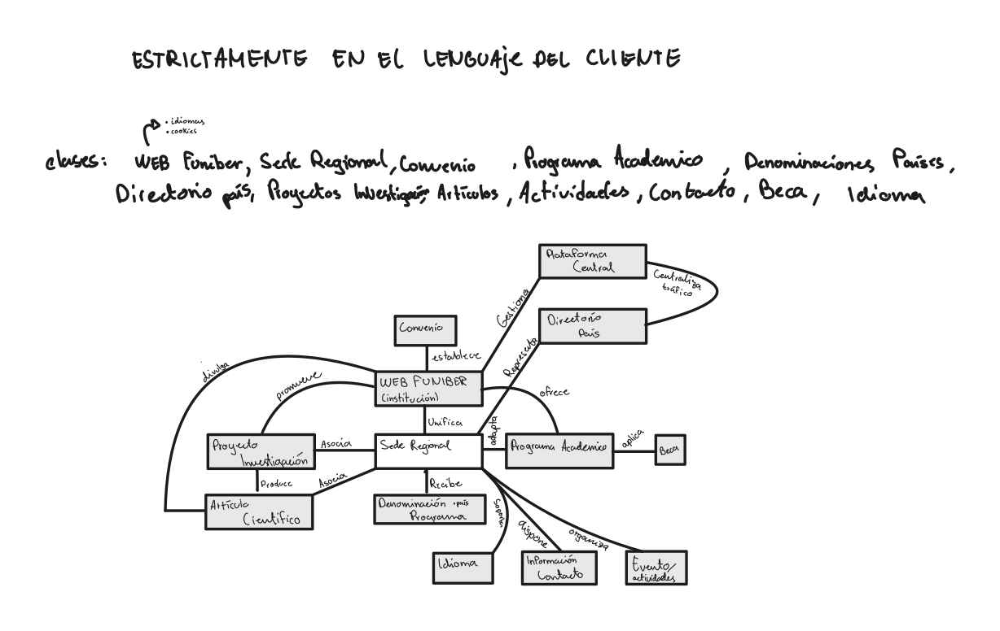

Con la informacion de la minuta de la primera sesion de requisitado, se propone el primer esbozo de nuestro planteamiento para el modelo del dominio. Durante la realizacion de este primer esbozo resaltaron dudas y mejoras para nuesto planteamiento. Es importante dejar constancia de nuestro porceso razonamiento, para asi poder mejorar y poder llegar a la solucion donde nuestro cliente este satisfecho.

